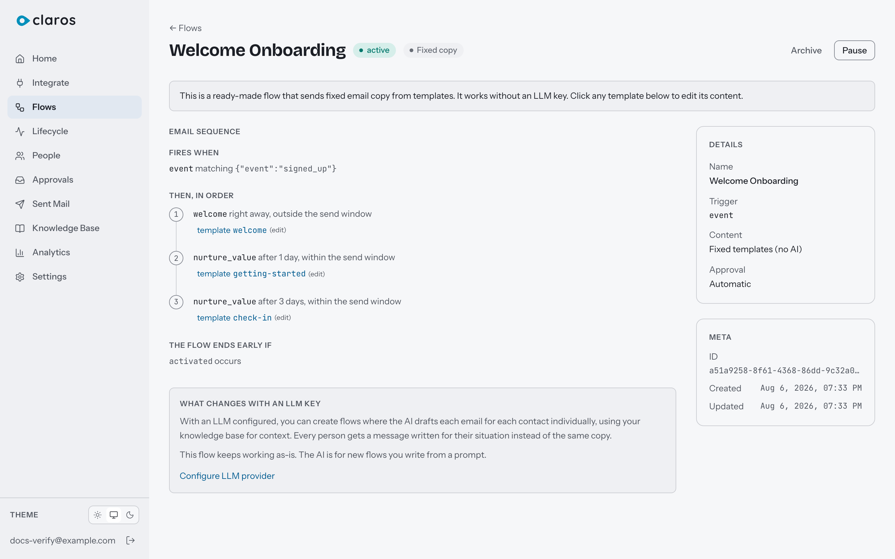
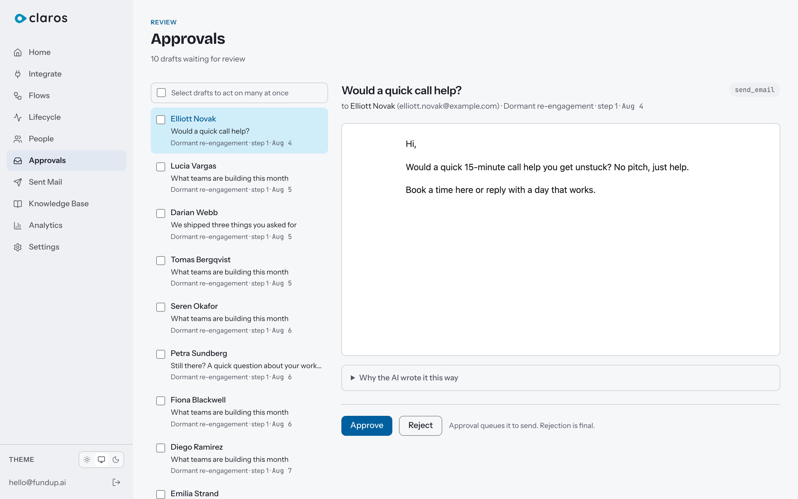

# Concepts and Guides

Loomail is unconventional in one deliberate way: there is no visual flow builder. Flows are written as plain-language prompts, compiled once into a deterministic plan, and executed by an engine that never calls an AI. This page explains that model, then gives short guides for the tasks people actually try first.

Contents:

- [The mental model](#the-mental-model)
- [How an event becomes an email](#how-an-event-becomes-an-email)
- [Compilation: prompts in, deterministic plans out](#compilation-prompts-in-deterministic-plans-out)
- [The approval queue](#the-approval-queue)
- [Three ways to produce email content](#three-ways-to-produce-email-content)
- [Flow mechanics](#flow-mechanics) (triggers, classes, re-entry, windows)
- [Guides](#guides)

---

## The mental model

Four objects, one direction:

```
Event  ->  Contact  ->  Flow membership  ->  Message
(track/identify)  (one per userId)  (compiled plan executes)  (one email)
```

- **Events** arrive through the ingestion API (`/v1/track`, `/v1/identify`, `/v1/batch`, Segment-compatible). See [INGESTION.md](./INGESTION.md).
- **Contacts** are the people. One contact per `userId` (stored as `external_id`). Email addresses are optional and unique when present. Every contact has a lifecycle state (`signed_up`, `activated`, `engaged`, `at_risk`, `dormant`, `churned`, `resurrected`) that the engine maintains from their activity.
- **Flows** are the automations. A flow has a trigger, a compiled plan of steps, and policies. When a contact matches a trigger, the engine enrolls them: they become a flow membership.
- **Messages** are individual emails. Each step a membership reaches creates exactly one message, which is generated, optionally approved, and sent.

The engine is deterministic. Everything below the flow is Postgres jobs and SQL. AI participates in exactly two places, both off the execution path: compiling a flow's prompt into its plan, and drafting a message's copy before it enters the approval queue.

## How an event becomes an email

Using the quickstart path as the example (`signed_up` event, welcome flow active):

1. `POST /v1/track` stores the event and resolves the contact (find-or-create by `userId`). Identifying first with `traits.email` gives the contact an address; without one, messages cannot be sent to them.
2. Ingestion immediately queues a trigger check. Active, compiled flows whose trigger matches the event enroll the contact. Guards run here: suppression list first, then the one-active-nurture-flow rule, then the re-entry policy.
3. The membership advances to step 1. Its delay (`0m` for the welcome email) has already elapsed, so a message is created.
4. Content generation produces the copy. For the library flow this is instant (fixed templates); for AI-drafted flows the brain decides whether to send, drafts, and scores the draft for value.
5. The message lands in the approval queue, or skips it if the flow's approval mode is `auto`.
6. The drain worker picks up approved messages, checks compliance gates (postal address set, signing key present, production URL sane) and the throttle (suppression, frequency caps, send window), injects one-click unsubscribe headers and the postal footer, and hands the message to your transport.
7. With Resend, opens, clicks, bounces, and complaints come back through the webhook and appear on the message and contact. Feedback only moves forward (`sent` → `opened` → `clicked`), never backward.

**Timing you should expect.** On the happy path this takes seconds: workers poll every 2 seconds and each stage hands off to the next. AI-drafted content adds LLM latency (three calls, typically seconds to a minute). Steps with delays wait for the delay, re-checked on the 15-minute scan. Lifecycle-transition and segment triggers are evaluated on the same 15-minute scan, so they can lag an event by up to 15 minutes. If a queued job is ever lost, 15-minute sweeps catch everything; the worst case from event to send is roughly 35 minutes.

## Compilation: prompts in, deterministic plans out

A prompt-defined flow starts as plain language:

> When a user signs up, send a welcome email immediately. If they have not activated after 2 days, send a getting-started guide. After 5 days, send a case study. Exit the flow as soon as they activate.

Pressing **Compile** sends the prompt to your configured LLM exactly once. The result is a JSON execution plan: an ordered list of steps with delays, conditions, send-window policies, and exit conditions, validated against a strict schema before it is stored. If the model produces something invalid, compilation fails safely and nothing changes.

From then on the plan, not the prompt, is what runs. The engine reads it with SQL. The same prompt compiled twice produces equivalent plans, and the plan is inspectable in the flow editor, so there are no surprises at send time.



Recompiling happens only when you ask (prompt changed, or a membership froze on an unrecognized condition). Editing a flow's prompt does nothing until you compile it again.

Rules that follow from this design:

- Compilation and AI drafting need an LLM provider configured. Everything else does not.
- The LLM never decides timing at send time. Delays, windows, and throttles are computed by the engine.
- Conditions are a closed vocabulary (below). Plans cannot contain arbitrary predicates.

**Conditions inside a flow.** A step can carry a condition ("send this email only if...": false skips the step and the flow moves on) and an exit condition ("stop the whole flow instead if..."), and a plan can carry exits that are checked before every step. A condition is one check, or an `all` / `any` group of checks (nesting up to 3 deep, at most 10 checks in total):

| Check | Examples |
|---|---|
| Lifecycle stage | is / is not `at_risk` |
| Payment status, plan, engagement, has an email | `paid`, plan is `Pro`, engagement is not `minimal` |
| A custom trait (any key you send in `identify`) | `seats` greater than 10, `country` is `Ghana`, `beta` is set |
| Something they did | did / did not `exported_report`, in the last N days, since reaching this step, or since entering the flow; "did" can ask for at least N times |

These are the same contact checks a trigger audience uses (see *Audience* above), plus lifecycle stage and events. In the flow editor, a hand-written step has a *Conditions (optional)* section and the flow has *Stop the flow early*. The same shapes through the API, on `POST /v1/flows/:id/plan`:

```json
{ "steps": [ { "order": 1, "delay": "0m", "action_type": "nurture_reactivate", "window_policy": "respect_window",
    "subject": "...", "body_html": "...",
    "condition": { "all": [
      { "field": "payment_status", "op": "is", "value": "paid" },
      { "field": "event", "name": "exported_report", "op": "not_performed", "within_days": 7 } ] } } ],
  "exit_conditions": [ { "condition": { "field": "event", "name": "upgraded", "op": "performed", "since": "flow" } } ] }
```

Things to know:

- **An event check needs a window.** Say `within_days` (back from now), `since: "step"` or `since: "flow"`. `since: "step"` has no meaning in a plan-level exit, where it counts from entering the flow.
- **Checked when the step comes due**, not when the contact entered. Contact fields are read at that moment, so a contact who upgrades during a wait is judged on their plan then.
- **A condition the engine cannot read does not guess.** The contact stays where they are and the reason is recorded on the membership (`condition_error`); it clears when the flow is fixed or recompiled. The API refuses to save one, so this only happens to hand-edited data.
- **The three original shapes** (`lifecycle_state`, `lifecycle_state_not`, `event_since_step`) are unchanged and still valid anywhere a condition goes.
- **Plain-English flows** use the same vocabulary: the AI is told these shapes when it compiles. It is told to use a custom trait only when your description names one.

## Flows that split into paths

A flow is a straight line by default: every contact gets the same emails in the same order. A **split** sends different contacts down different paths. After the emails above it, the flow waits (or not), checks a condition, and sends the contact down the **If it holds** path or the **Otherwise** path. Each path is its own list of emails, and each can end in a split of its own.

> Welcome email. Wait 3 days. **Did they create a project?**
> Yes: send "Nice work, here is what to do next".
> No: send "Stuck? Here is a quick guide".

In the flow editor (for flows you write yourself), press **Split into two paths** under the last email. The condition is the same kind used everywhere else (see *Conditions inside a flow*): contact facts, lifecycle stage, and what they did, combined with all-of or any-of. The plan preview draws the paths as an outline. For plain-English flows, describe the fork in your prompt (see [FLOW-PROMPTS.md](./FLOW-PROMPTS.md)) and the AI writes it.

Rules, which the editor enforces and the API checks:

- **A split is the last thing in its path.** When a path runs out of emails, the flow ends for that contact. An empty path is fine: "otherwise, do nothing".
- **At most 3 splits on any one path, and 30 emails and splits in total.**
- **No loops.** A contact can never be sent back to an earlier step, so nobody can be mailed forever. A plan with a loop, a path to a step that does not exist, or a step nothing leads to is refused with a message saying which.
- **The wait counts from arriving at the split**, not from the previous email. The check happens when that wait is over, and what the contact did since arriving can be asked with "since this step".
- **The decision is made once.** Contacts are not moved between paths later if the answer changes.
- **A decision never sends an email by itself.** The first email on the chosen path goes out straight away if it is due; later ones follow their own delays.
- **A step's own condition is different from a split.** "Send this email only if..." skips just that email and moves on. A split chooses a whole path.
- **Straight-line flows are unchanged.** A flow without a split is saved exactly as before.

The same through the API, on `POST /v1/flows/:id/plan`. A plan with splits has `version: 2`. Emails and splits share one numbering (`order`), the flow starts at order 1, and each email says what comes `next` (another order, or `"end"`). A split has a `delay`, a `condition`, and `then` / `else` targets:

```json
{ "version": 2,
  "steps": [
    { "order": 1, "delay": "0m", "action_type": "onboard_welcome", "window_policy": "immediate",
      "subject": "Welcome", "body_html": "<p>...</p>", "next": 2 },
    { "order": 3, "delay": "0m", "action_type": "nurture_value", "window_policy": "respect_window",
      "subject": "Nice work", "body_html": "<p>...</p>", "next": "end" },
    { "order": 4, "delay": "0m", "action_type": "onboard_guide", "window_policy": "respect_window",
      "subject": "Stuck?", "body_html": "<p>...</p>", "next": "end" } ],
  "branches": [
    { "order": 2, "delay": "3d",
      "condition": { "field": "event", "name": "project_created", "op": "performed", "since": "flow" },
      "then": 3, "else": 4 } ] }
```

### Waiting for something to happen

A split can also **wait for an event instead of waiting a fixed time.** In the editor, choose *Wait for it to happen, up to a limit* on a split. The time you pick becomes the longest the contact will wait.

> Welcome email. **Wait up to 3 days for "created a project".**
> They did, at any point in those 3 days: send "Nice work", straight away.
> 3 days passed and they did not: send "Stuck? Here is a quick guide".

- **The condition is checked on every 15-minute scan while they wait**, so "straight away" means within about 15 minutes of it happening. When the time runs out the normal check decides, so something that happens on the last day still counts.
- **Use "since this step" for events** so only what happens after the contact reached the wait counts. With "within the last N days" an event from before they arrived can end the wait at once.
- **It works for any condition,** not just events: "wait up to 7 days for payment status to become paid" is the same thing.
- **The limit is required, from 1 minute up to 90 days.** Nobody waits forever.
- **Everything else about splits applies:** the decision is made once, a split is the last thing in its path, no loops, and the same node limits. A condition the engine cannot read is reported while waiting, not guessed.
- **Through the API:** add `"early": true` to the branch. Its `delay` is the longest to wait. A branch without `early` is unchanged.

```json
{ "order": 2, "delay": "3d", "early": true,
  "condition": { "field": "event", "name": "project_created", "op": "performed", "since": "step" },
  "then": 3, "else": 4 }
```

The API accepts more shapes than the editor builds: paths may rejoin (two emails can both lead to a shared one), and a step can jump over others with `next`. The plan preview shows these as "Continues at step N". The editor itself only builds the tree shape above.

## The approval queue

AI-drafted flows default to `approval_mode: require`: every generated message waits in **Approvals** until a human approves or rejects it. This is the trust mechanism. The AI writes, you publish.



- Approve sends within seconds; reject discards permanently. Bulk approve/reject handles up to 100 at a time.
- Unapproved messages wait forever. Nothing auto-sends, nothing expires.
- Fixed-content flows default to `auto` because a human already wrote the copy.
- Approval mode is per flow. A common pattern: `require` while a flow is new, switch to `auto` once you trust its output.
- Messages that fail generation land in `failed` with the reason attached, and can be retried from the queue.

## Three ways to produce email content

1. **AI-drafted** (`ai_drafted`). Each step carries an instruction for the drafter. Per contact per step, the brain runs decide (send, wait, or skip), draft (write the email), and assess (is this worth sending; if not, the message is value-gated and dies quietly). Personalization comes from the contact's events, traits, lifecycle state, and your knowledge base entries. Requires an LLM provider.
2. **Human-written** (`fixed_content`). You write the subject and body for each step in the flow editor; they are stored as templates with variable interpolation. No LLM involved at any point. This is how the library flow works, and it is the recommended way to get comfortable before turning on AI drafting.
3. **AI-assisted human copy**. While editing a fixed-content step, you can ask the AI for a draft of that step, edit it, and save it as your own. The AI contributes once, at writing time; the result is ordinary fixed content. Requires an LLM provider.

You can mix approaches across flows, and reference your own templates (`@template:name`) and knowledge base entries (`@kb:name`) inside prompts.

## Flow mechanics

**Triggers.** Four types, three of which enroll today:

| Trigger | Config | Enrolls |
|---|---|---|
| `event` | an event name, e.g. `signed_up` | Yes, near-instant. Only `track` calls trigger flows; `identify` does not |
| `lifecycle_transition` | from-state, to-state | Yes, on the 15-minute scan |
| `segment` | a saved segment (`{segment_id}`), or one cell of the retention grid (`{tenure_bucket, recency_bucket}`) | Yes, on the 15-minute scan, capped at 200 enrollments per flow per scan |
| `manual` | - | Accepted by the API but not wired to enrollment yet |

A segment trigger starts the flow for everyone who is in the segment now and anyone who joins later. The rules are read at each scan, so editing a segment changes who enters from then on; people already in the flow stay. The older form, one **retention-grid cell** (tenure `new`, `growing`, `established`, `loyal` crossed with recency `active`, `cooling`, `idle`, `dormant`), still works unchanged and is what the Analytics grid links to.

## Segments

A **segment** is a saved description of a group of people ("paid customers not seen in 14 days"), not a fixed list. Loomail works out who matches whenever it is asked. Build them under **Segments**, or press *Save as segment* on the People page.

A segment has a match mode (**all** or **any**) and up to 20 rules in total. One level of nested groups is allowed, with up to 10 rules per group, so "paid AND (power OR regular)" is expressible. Rules can be about:

- **Contact facts**: payment status, engagement depth, plan, has an email, or a custom trait.
- **Lifecycle stage**: is, is not, or is one of.
- **First or last seen**: within, or more than, N days ago.
- **What they did**: performed or did not perform an event in the last N days (up to 365), optionally at least N times.

Things to know:

- **Counts are cached.** The list shows the count from the last time it was worked out, with the time; press recount to refresh. Counting stops at 100,000 (shown as "100,000+") and a count that takes more than a few seconds is refused rather than left running.
- **A flow that uses a segment pins it.** A segment cannot be archived while a flow starts from it; the API (422) and the page name the flows.
- **Suppressed people never enroll**, and the usual re-entry and concurrency settings of the flow still apply. Candidates are filtered before the 200-per-scan cap so blocked people cannot starve the rest.
- **Event rules on a name never sent** match nobody (or everybody, for "did not"); the editor warns when the name has never been seen.
- **Through the API**: `GET/POST /v1/segments`, `GET/PATCH/DELETE /v1/segments/:id`, `POST /v1/segments/:id/refresh`, `POST /v1/segments/preview`, and `GET /v1/contacts?segment_id=`.

**Audience (optional).** An `event` or `lifecycle_transition` trigger can carry an audience: "only enroll contacts where...". In the flow editor it is the *Only for certain contacts* section, and unlike the trigger it can be changed at any time, even on an active flow, without recompiling. Up to 5 conditions, all of which must hold:

| Condition | Operators |
|---|---|
| Payment status (`free`, `trial`, `paid`, `past_due`, `cancelled`) | is, is not, is one of |
| Engagement (`power`, `regular`, `casual`, `minimal`) | is, is not, is one of |
| Plan (the `plan` trait, when it is a plan name) | is, is not |
| Email address | has one / has none |
| A custom trait (any key you send in `identify`) | is, is not, contains, greater than, less than, is set, is not set |

The same shape through the API, in `trigger_config`:

```json
{ "from": "engaged", "to": "at_risk",
  "audience": { "conditions": [
    { "field": "payment_status", "op": "is", "value": "paid" },
    { "field": "plan", "op": "is", "value": "Pro" } ] } }
```

Things to know:

- **It is checked at the moment the trigger fires.** A contact who does not match then is not enrolled for that occurrence, and is not enrolled later if they start matching. Contacts already in the flow are not affected when you change the audience.
- **Traits must be there when the event arrives.** For event triggers, send `identify` before `track` (the server SDKs do). A `track` that beats its `identify` is judged on the traits known so far.
- **Text comparisons ignore case.** A missing trait never matches "is", "contains", "greater than" or "less than", and always matches "is not". Numbers stored as text (`"12"`) compare as numbers.
- **A filter the engine cannot read enrolls nobody** (it fails closed) and logs a warning. The API refuses to save one, so this only happens to hand-edited data.
- **Not for segment (retention grid) triggers.** The API rejects an audience there.
- The audience is not shown to the AI that compiles or drafts the flow; the engine enforces it.

**Classes.** Every flow is `nurture` or `critical`. A contact can be in at most one active nurture flow at a time; a higher-priority flow evicts the current one. Critical flows (dunning, limits) have no concurrency limit and bypass the frequency caps and send window. Nothing bypasses the suppression list.

**Re-entry.** Per flow: `once`, `cooldown` (default 30 days), or `every_time`. Enforced by a uniqueness constraint on active memberships, so races cannot double-enroll.

**Send windows.** Each step is `immediate` (welcome, dunning: ignores the send window) or `respect_window` (waits for 09:00-17:00 weekdays, or whatever you configure). Frequency caps (1/day, 2/week, 48h gap by default) apply to everything except critical flows.

---

## Guides

### Write your first prompt-defined flow

1. Configure an LLM provider (Settings → LLM, or `loomail llm set`). Without one, use fixed content instead: steps 2-4 still work, you just skip compilation and write each step's copy yourself.
2. Flows → New flow. Choose the trigger (an event name your app sends, a lifecycle transition, or a retention-grid cell) and write the prompt. [FLOW-PROMPTS.md](./FLOW-PROMPTS.md) has working starting points.
3. Compile. Read the generated plan in the editor; check the delays, conditions, and exit conditions match your intent. Fix the prompt, recompile.
4. Activate the flow. New matching contacts enroll from that moment.
5. Watch **Approvals** for the first messages. Approve a few, and switch the flow to auto-approve when you trust it.

Verify it works by firing the trigger at yourself, exactly like steps 9-11 of [QUICKSTART.md](./QUICKSTART.md).

### Set up open and click tracking (Resend only)

1. Save your Resend transport first; note your tenant ID (see [INSTALLATION.md](./INSTALLATION.md#email-transport)).
2. In the Resend dashboard, create a webhook pointing at `https://<your-host>/webhooks/resend/<tenantId>` and subscribe to the `email.*` events.
3. Copy the webhook's signing secret into your transport config (`webhook_secret` field, Settings → Transport or `loomail transport set`).
4. Opens, clicks, bounces, and complaints now appear on messages and contacts. Permanent bounces and complaints also add the address to your suppression list automatically.

SMTP transports have no feedback channel; there is nothing to configure.

### Import a suppression list from your old provider

Settings → Sent → Suppressions → Import, paste one address per line (up to 10,000). Or:

```bash
curl -X POST http://localhost:3000/v1/suppressions/import \
  -H "Cookie: loomail_session=<your-session>" \
  -H "Content-Type: application/json" \
  -d '{"addresses":["old-unsub-1@example.com","old-unsub-2@example.com"]}'
```

Suppressed addresses are blocked at enrollment and again at send, for every flow including critical ones. Transactional auth email (login links, invites) is the only exception.

### Apply a business model template

If your product is a freemium, time-limited trial, or preview-free SaaS, applying the matching template (offered during first-run setup, or via the API) seeds sensible lifecycle tuning, throttle settings, and a set of draft flows with pre-written prompts for your model. The flows arrive as drafts: review their prompts, compile, and activate the ones you want. Templates can be applied once per workspace.

---

Next: [FLOW-PROMPTS.md](./FLOW-PROMPTS.md) for a library of working flow prompts, [FAQ.md](./FAQ.md) for troubleshooting.
